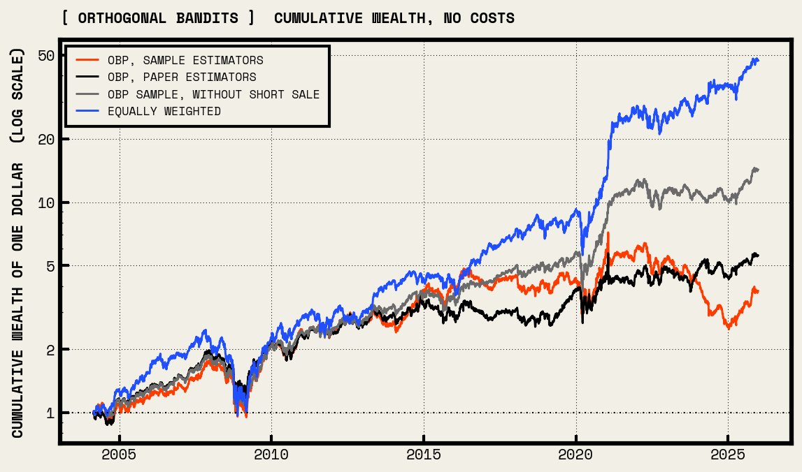
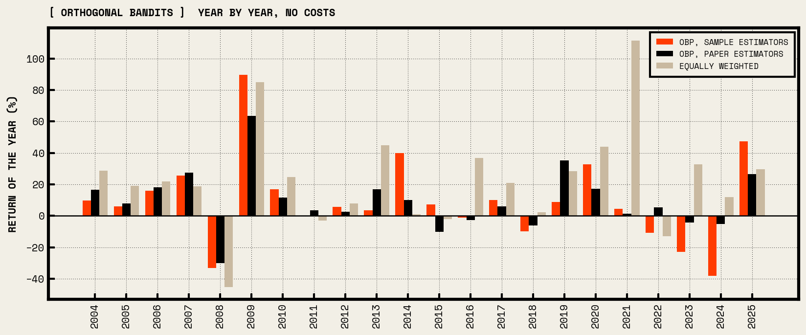
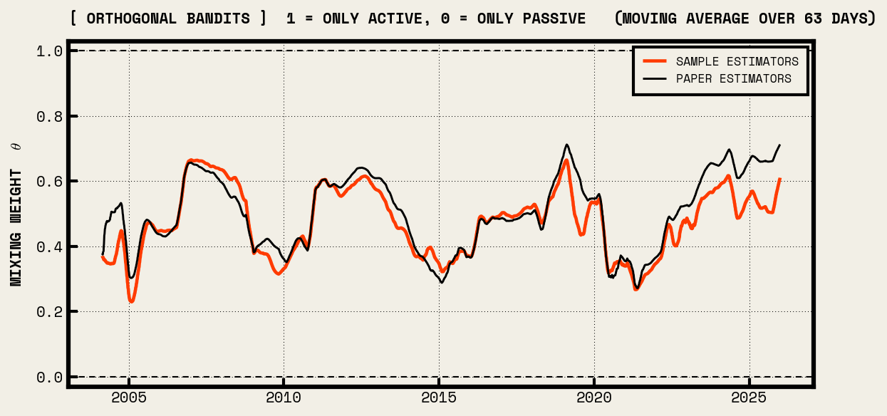
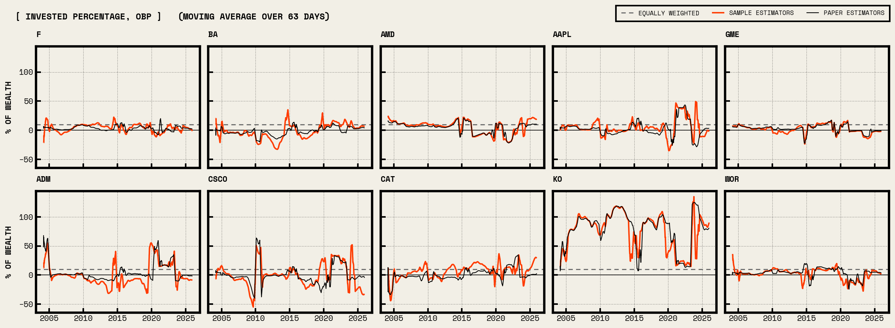
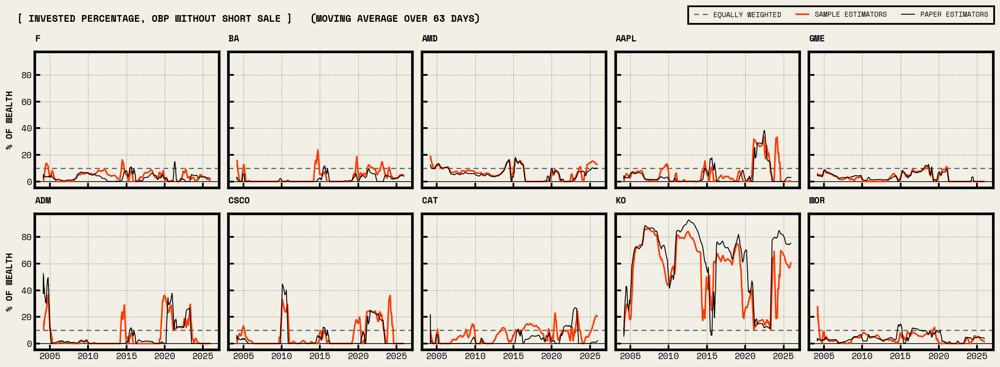

# orthogonal-bandits
Orthogonal Bandit Portfolios (OBP), after

> W. Shen, J. Wang, Y.-G. Jiang, H. Zha. *Portfolio choices with orthogonal bandit learning.* Proceedings of the 24th International Joint Conference on Artificial Intelligence (IJCAI), pp. 974-980, 2015. [Paper](https://www.ijcai.org/Abstract/15/142)

## The method

At every step, from the gross returns `R = S_k / S_{k-1}` of the previous `tau` days:

1. decompose the covariance of the assets, `Sigma = H Lambda H^T` (eq. 5);
2. normalize every eigenvector to a portfolio whose weights sum to one, `Ht_i = H_i / (H_i^T 1)`, with variance `lt_i = lambda_i / (H_i^T 1)^2` (eq. 7, 8);
3. give every portfolio the reward `r_i = Ht_i^T E[R] / sqrt(lt_i)`, its Sharpe ratio (eq. 10);
4. choose, with an upper confidence bound `r_i + sqrt(2 ln(k + tau) / (tau + k_i))` (eq. 11), one portfolio among the first `l` (passive) and one among the others (active);
5. mix them with minimum variance, `theta = lt_i / (lt_i + lt_j)`, `w = (1 - theta) Ht_i + theta Ht_j` (eq. 12, 13);
6. realize the return `w^T R - 1` of the next day.

### Estimators

Covariance and mean are estimated in two ways, and both are run and plotted:

| | `Sigma` | `E[R]` |
|---|---|---|
| sample | sample covariance | sample mean |
| paper | factor model | James-Stein shrinkage |

- **Factor model** (J. Fan, Y. Fan, J. Lv, *High dimensional covariance matrix estimation using a factor model*, Journal of Econometrics 147, 186-197, 2008, eq. 1.4; [preprint](https://arxiv.org/abs/math/0701124)): the excess returns are regressed on the factors without intercept, `y = B f + e`, and `Sigma = B cov(f) B^T + diag(E E^T / T)`, with `E` the residuals.
- **James-Stein** (A. Meucci, *Risk and Asset Allocation*, Springer, eq. 4.138-4.139): `(1 - alpha) mean + alpha b`, with `alpha = (tr S - 2 lambda_max(S)) / (T |mean - b|^2)` kept in `[0, 1]`, `S` the sample covariance and `b` a fixed vector.

The paper does not say which factors nor which `b` it uses. Here the factors are the three daily Fama-French factors ([data library](https://mba.tuck.dartmouth.edu/pages/faculty/ken.french/data_library.html)) and `b = 1`, a gross return of one (no net return).

Other differences from the paper: `l` is a parameter (the paper takes it where the eigenvalues drop), and the data are daily with `tau = 500` (the paper: weekly or monthly, 120). The portfolio without short sale (negative weights set to zero, the others rescaled) is not in the paper.

## Usage

```
pip install -r requirements.txt
python obp.py                                           # 2002-2025, figures in fig/
python obp.py --start=2007-09-01 --end=2010-01-09       # the period of the first version
python -m pytest test_obp.py
```

The first run of a period downloads the prices from Yahoo (adjusted for splits and dividends) and the Fama-French factors, and saves them in `data/`, which later runs read. Use `--out` to keep the figures of another run.

| option | default | |
|---|---|---|
| `--tickers` | `F BA AMD AAPL GME ADM CSCO CAT KO WOR` | US listed (there is no currency conversion) |
| `--start`, `--end` | `2002-03-01`, `2026-01-01` | period of the prices, end excluded (GME is listed from February 2002) |
| `--tau` | 500 | days of the rolling window |
| `--l` | 3 | number of passive portfolios |
| `--cost` | 10 | transaction cost in basis points of the value traded |
| `--prices` | `data/prices_<start>_<end>.csv` | your own prices in USD: a column for the date, one for every ticker |
| `--factors` | `data/factors.csv` | daily factors `Mkt-RF`, `SMB`, `HML` and `RF` as decimal returns |
| `--out`, `--no-plot` | `fig/` | figures |

With the defaults there are 5998 daily returns; the first 500 form the first window and 5498 days are traded (2004-02-26 to 2025-12-31).

## Results

Cumulative wealth of one dollar for OBP with the two sets of estimators, OBP without short sale (sample estimators) and the equally weighted portfolio (EW), without costs, on a logarithmic scale:



| 5498 days | mean (daily) | std (daily) | Sharpe ratio (daily) | terminal wealth | t vs EW | daily turnover | Sharpe, 10 bp | wealth, 10 bp |
|---|---|---|---|---|---|---|---|---|
| OBP, sample | 0.00034 | 0.0140 | 0.024 | 3.77 | -2.60 | 0.093 | 0.018 | 2.26 |
| OBP, paper estimators | 0.00040 | 0.0135 | 0.030 | 5.56 | -2.32 | 0.044 | 0.027 | 4.36 |
| OBP, sample, without short sale | 0.00056 | 0.0123 | 0.046 | 14.19 | -2.25 | 0.044 | 0.042 | 11.16 |
| OBP, paper, without short sale | 0.00056 | 0.0120 | 0.047 | 14.53 | -2.02 | 0.023 | 0.045 | 12.79 |
| EW | 0.00082 | 0.0157 | 0.052 | 46.64 | | 0.013 | 0.052 | 43.39 |

**On this period and these stocks OBP is worse than equal weighting.** It has a lower volatility, but its mean return is lower by more than that: the Sharpe ratio (without subtracting a risk free rate, as in the paper) and the terminal wealth are below those of EW, and the t statistic of the mean daily difference is about -2 or lower. Costs widen the gap.

- `t vs EW` is the t statistic of the mean of the daily differences of the returns. It does not adjust for the risk.
- Turnover is the value traded in a day per unit of wealth. A cost of 10 basis points on it is an illustrative figure of mine, and borrowing the assets sold short costs nothing here. With 20 basis points the terminal wealth is 1.4, 3.4, 8.8, 11.3 and 40.4, in the order of the table.
- The mean gross exposure `sum |w|` is 1.8 with the sample estimators and 1.5 with those of the paper.

### Year by year



In 22 years OBP beats EW in 8 with the sample estimators and in 6 with those of the paper. The estimators of the paper beat the sample ones in 12.

The first version of this project covered only 2007-09 to 2010-01, with 92 traded days (2009-08 to 2010-01). There OBP with the sample estimators ended at 1.35 against 1.29 for EW: a short, favourable window, with a t statistic of 0.4.

### Robustness

Daily Sharpe ratio and terminal wealth, no costs:

| setting | OBP, sample | OBP, paper | sample, no short sale | paper, no short sale | EW |
|---|---|---|---|---|---|
| from 2006-02, `tau = 250` | 0.042 / 12.9 | 0.039 / 9.7 | 0.051 / 18.0 | 0.051 / 15.9 | 0.049 / 26.6 |
| from 2006-02, `tau = 500` | 0.023 / 3.0 | 0.027 / 4.0 | 0.044 / 10.6 | 0.044 / 10.2 | 0.049 / 26.6 |
| from 2006-02, `tau = 1000` | 0.033 / 6.2 | 0.032 / 5.5 | 0.047 / 12.6 | 0.045 / 11.2 | 0.049 / 26.6 |
| from 2004-02, without GME | 0.027 / 4.4 | 0.033 / 6.3 | 0.043 / 11.7 | 0.045 / 12.5 | 0.048 / 28.2 |
| from 2004-02, `l = 1` | 0.031 / 6.6 | 0.042 / 15.1 | 0.045 / 15.8 | 0.048 / 18.4 | 0.052 / 46.6 |
| from 2004-02, `l = 5` | 0.024 / 3.6 | 0.031 / 6.2 | 0.046 / 14.8 | 0.049 / 16.6 | 0.052 / 46.6 |

EW has the larger terminal wealth in every row. The only Sharpe ratios above that of EW are those without short sale at `tau = 250`, by 0.002. Neither set of estimators is better in every row.

**Limits.** The ten stocks were chosen today among companies for which data exist, which flatters long positions in them, those of EW most of all. Twenty years mix very different markets.

### The James-Stein shrinkage hardly matters

Eq. 4.139 is positive only if the largest eigenvalue is less than half of the trace. This happens on 2966 of the 5498 days, with a median `alpha` of about 0.1, but with the factor model covariance the shrinkage changes the weights on 2 days only. The reason: the weights of every principal portfolio sum to one, `Ht^T 1 = 1`, so shrinking the mean towards `b = 1` gives the reward `(1 - alpha) Ht^T mean / sqrt(lt) + alpha / sqrt(lt)`. It adds a multiple of the inverse volatility, which the reward is already close to (see below). The same holds for any `b` with equal components. The two sets of results differ because of the covariance.

Mixing weight `theta` (1: only the active portfolio, 0: only the passive one), averaged over 63 days:



Invested percentage for OBP, averaged over 63 days. Negative values are short sales:



Invested percentage without short sale, averaged over 63 days:



## The bandit hardly explores

With gross returns, as in the paper, `Ht^T E[R]` is 1 plus a mean daily return, which is small unless the portfolio is strongly leveraged. So the reward is nearly `1 / sqrt(lt)`, the inverse of the volatility of the portfolio, and the confidence bound can matter only between two almost equal rewards. With either set of estimators the choice is the least volatile portfolio of its group on at least 99.8% of the days. The result is then set by the covariance estimate and by `l`, which fixes the groups.
